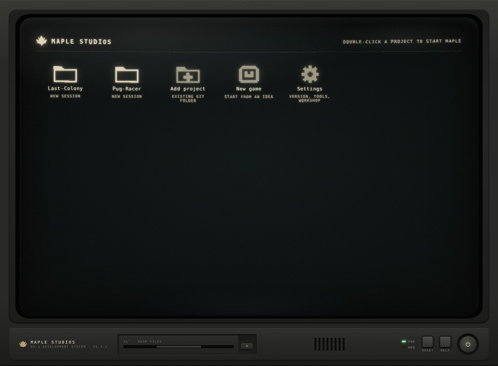
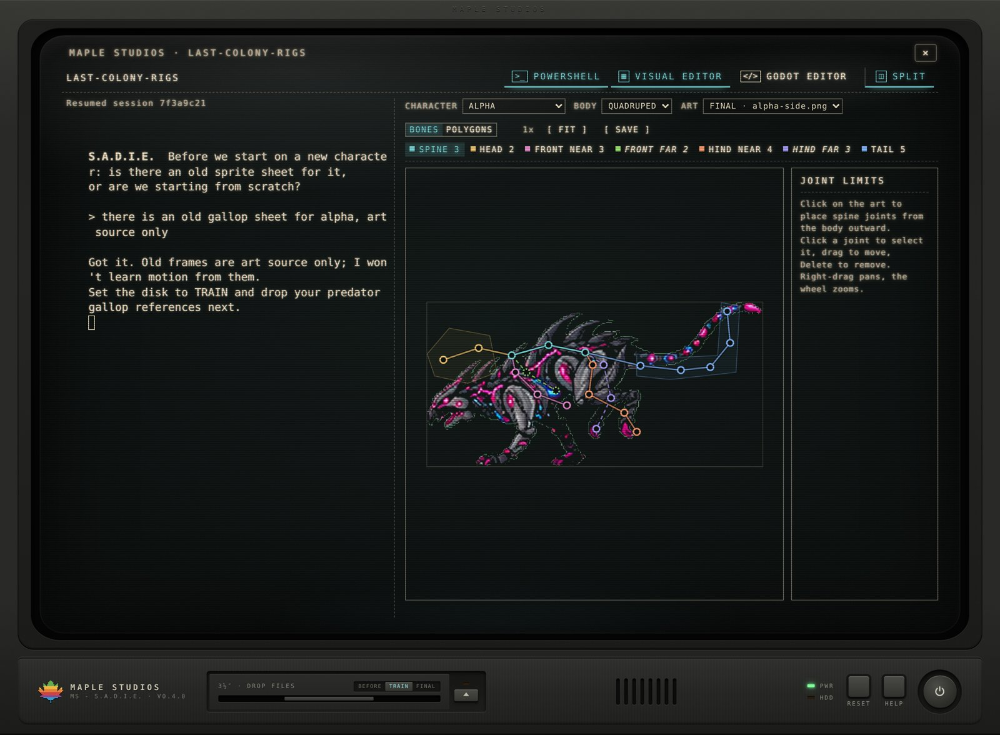

<p align="center"> boot jddominick. Loading agent architectures, toolchains and game engines. Loading science fiction 87%." width="100%"></p>

### Jesse

Tool builder and systems developer, and the developer behind **Maple Studios**. I design agent architectures, build the tools around them, and use the most modern technology I can get my hands on to make science fiction a little more real each day.

Science guy. Sci-fi lover. Bringing science fiction to reality one line of code at a time.

---

## `> maple_studios`

**An autonomous game-development agent platform with its own cognitive architecture.**

<p align="center"></p>

Maple is a desktop application I designed and built from the ground up: an Electron workstation that hosts a Claude Code agent, gives it a persistent, structured mind, and wires it into a full production toolchain. It ships as a self-updating desktop app for Windows and macOS.

**Brain stem architecture.** Agent cognition is split into layers with clear boundaries. An immutable **core** defines identity and working method. A per-project **long-term memory** archive holds decisions, recipes and a task log, retrieved on demand instead of loaded wholesale. A **short-term memory** lives inside each project and tracks active state. Separation of layers keeps context lean and keeps the agent's view of a project accurate.

**Personality Matrix.** A runtime learning system. New behaviours, tools and rules enter as trial lessons, are evaluated against real work, and are only committed once they prove useful. Lessons override the core per user, and validated lessons can be promoted into the core and shipped in the next release.

**Learning without drift.** Learned behaviour and project state are stored separately, so the agent keeps improving without corrupting game progress or inventing history. It works from recorded facts, not guesses.

**Integrated CLI toolchain.** Maple orchestrates the full pipeline from the command line: Godot, Git, ffmpeg, TexturePacker, ImageMagick and more, with automatic detection and provisioning of anything missing.

**Under the hood.** Pseudo-terminal sessions pinned to per-project session IDs, guarded project registry, checkpointing on shutdown, PID-scoped process-tree control, and a CI pipeline that builds Windows and universal macOS releases with an in-app updater.

**[Maple Studios releases →](https://github.com/jddominick/Maple-Studios/releases/latest)**

## `> s.a.d.i.e.` *(in development)*

**Sprite Animation, Deformation & In-betweening Editor.** The next generation of the Maple architecture, built for character animation.

<p align="center"></p>

S.A.D.I.E. runs on the same game-dev agent architecture as Maple, pushed further. Advanced memory and learning let it study reference motion, keep every character and rig on record, and get sharper with each project. It's more powerful, more versatile, and has a bigger toolkit: a visual editor for skeletal rigging with polygon binding and joint constraints, a timeline, a live bridge into the Godot editor, motion learning from reference sheets, and TexturePacker export straight into the game. All of it lives in an upgraded CRT workstation with a split-view workspace and refined graphics.

**[S.A.D.I.E. releases →](https://github.com/jddominick/Animation-Studio/releases/latest)**

## `> last_colony`

A science-fiction game in Godot, and the production testbed for Maple and S.A.D.I.E.

---

```
C:\> stack --list
```


<p align="center"><sub><code>C:\> shutdown</code> · <em>thanks for stopping by</em></sub></p>
